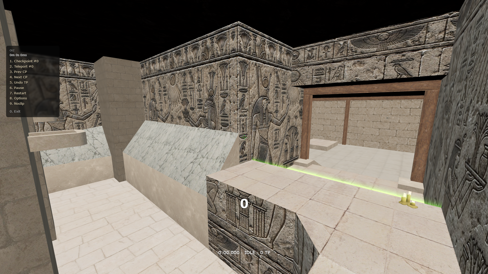
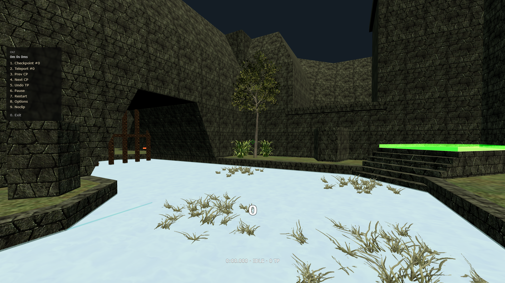
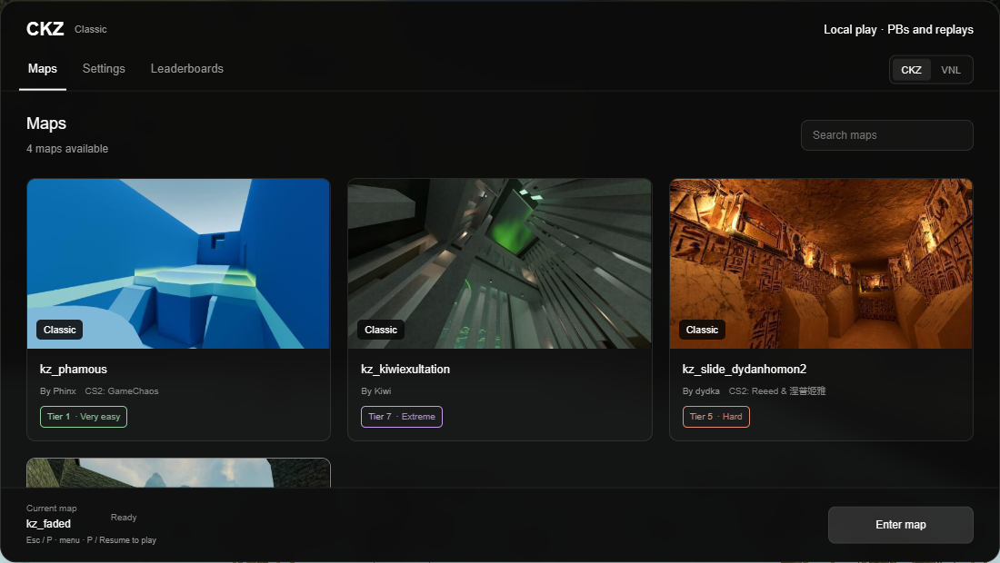
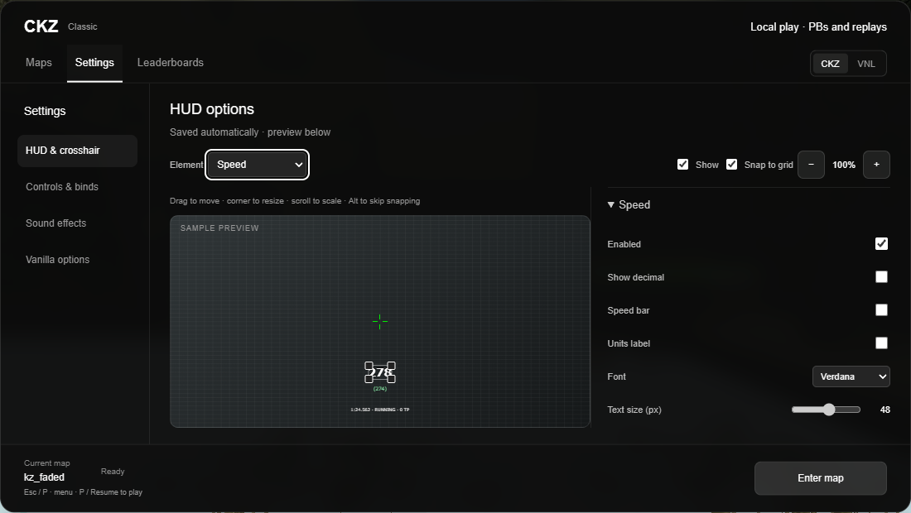

<div align="center">

# CKZ Webplayer

**KZ movement and practice maps, straight in your browser.**

[**Play the demo →**](https://ckz-three-map-demo.vercel.app) · [Maps](#maps) · [Controls](#controls) · [Run locally](#run-locally)

TypeScript · Three.js · Classic & Vanilla · Four maps

</div>



Practice strafing, bunnyhops, ladders and technical routes with checkpoints, course timers and a customizable HUD. CKZ Webplayer runs its movement simulation in the browser and loads prepared map geometry, collision and textures as static assets.

**Start with [Phamous](https://ckz-three-map-demo.vercel.app/?map=3104579274)** for the easiest Classic course, or try [Faded](https://ckz-three-map-demo.vercel.app/?map=3366047597) for a step up. No game installation or account is needed to play this demo.

## What's included

- **Two movement profiles:** Classic KZ and fixed-tick CS:GO-style Vanilla, with Vanilla timing options.
- **Practice tools:** checkpoints, teleport and undo, course restart, pause and noclip.
- **Run feedback:** course timing, local personal bests, jump reports and playback of the last completed local run.
- **A configurable HUD:** position and scale the speed display, timer, jump information and crosshair; tune controls and sound effects.
- **A standalone static build:** four maps, their active runtime assets and the player total **94.06 MB** in the deployed snapshot.

This version is **local play**: Steam sign-in, shared leaderboards and online replay hosting are disabled. Personal bests are browser-local; the last-run replay belongs to the current session.

## Maps

| Map | Author | Classic difficulty | Runtime assets |
| --- | --- | --- | ---: |
| [kz_phamous](https://ckz-three-map-demo.vercel.app/?map=3104579274) | Phinx · CS2 port: GameChaos | **Tier 1 · Very easy** | 8.3 MB |
| [kz_faded](https://ckz-three-map-demo.vercel.app/?map=3366047597) | leetly | **Tier 3 · Medium** | 39.4 MB |
| [kz_slide_dydanhomon2](https://ckz-three-map-demo.vercel.app/?map=3801640043) | dydka · Workshop credits: Reeed & 涅普姬雅 | **Tier 5 · Hard** | 24.5 MB |
| [kz_kiwiexultation](https://ckz-three-map-demo.vercel.app/?map=3551310998) | Kiwi | **Tier 7 · Extreme** | 20.9 MB |

Sizes are rounded decimal MB and include each map's selected model, textures, collision and supporting data. Players load the selected map, rather than downloading all four at once. The full site total also includes the player, shared audio and notices.

Tiers above are the bundled Classic main-course ratings. Vanilla ratings can differ; Faded is tier 4 in Vanilla. Kiwiexultation's tier 7 is the local rating supplied for this project.



## Make it yours

Choose a map and movement profile, then set up your HUD and controls before entering the course. Preferences are saved locally in your browser.

<table>
  <tr>
    <td width="50%"></td>
    <td width="50%"></td>
  </tr>
  <tr>
    <td align="center"><strong>Choose your next route</strong></td>
    <td align="center"><strong>Arrange your HUD</strong></td>
  </tr>
</table>

The gameplay screenshots above were supplied by the project owner. The menu screenshots were captured from the live demo.

## Controls

Use a desktop browser with WebGL2, a mouse and a keyboard. Click **Enter map** to begin and capture mouse input. Fullscreen can also capture gameplay keys; if browser shortcuts interfere, use **C** to duck.

| Action | Default input |
| --- | --- |
| Move / look | **W A S D** / **Mouse** |
| Jump | **Space** or **Mouse wheel** |
| Duck / walk | **Ctrl** or **C** / **Shift** |
| Checkpoint / teleport | **1** / **2** in the KZ menu |
| Previous / next checkpoint | **3** / **4** |
| Undo teleport | **5** |
| Course restart | **R** |
| Noclip | **N** |
| Open / close KZ menu | **M** |
| Pause menu / resume | **Esc** or **P** |
| Developer console | **Backquote** |

Bindings and mouse sensitivity are under **Settings → Controls & binds**. The numbered KZ menu also exposes pause, restart and options. For local replay playback, use the finish panel or the console command `replay_last` after completing a run.

## Run locally

Requires **Node.js 24.15+** and npm. The runtime assets are included in this private repository; no converter, Steam download or Git LFS setup is needed to run it.

```sh
git clone https://github.com/lukewae/ckz-webplayer.git
cd ckz-webplayer
npm ci
npm run dev
```

Open the localhost URL printed by Vite. The development configuration enables the same local-play mode as the hosted demo, without requiring a backend.

```sh
npm test          # 49 focused movement, collision, ladder and input checks
npm run build    # TypeScript check, then rebuild demo/
npm run preview  # Serve the rebuilt demo locally
```

## Build & deploy

The committed **`demo/`** directory contains the tested four-map deployment. `vercel.json` serves that directory directly, with no remote install or build step.

After editing source, run `npm run build`, verify with `npm run preview`, and commit the regenerated `demo/` files before deploying. From the repository root:

```sh
npx vercel@latest
```

Select the intended Vercel account and project. Creating a GitHub repository does not automatically link it to the existing Vercel project.

The original committed snapshot uses versioned `/releases/…/maps/` URLs. A fresh source build copies the same required assets from `public/` and serves them at `/maps/`. Both layouts are self-contained.

<details>
<summary><strong>Repository layout</strong></summary>

| Path | Contents |
| --- | --- |
| `src/` | Player, movement simulation, map loading, UI and local replay tools |
| `shared/` | Replay validation and movement-profile helpers |
| `public/` | Four maps' runtime dependencies, thumbnails, audio and notices |
| `demo/` | Ready-to-deploy static player and assets |
| `tests/` | Headless movement and input regression tests |
| `docs/` | Screenshots and selected historical implementation audits |
| `licenses/` | Upstream licences and attribution notices |

Identical asset blobs in `public/` and `demo/` are deduplicated by Git. Local dependencies, credentials and temporary verification output are excluded from the repository.

</details>

## Scope & attribution

This is a browser movement prototype, with native exported collision and selected map rules. It does not claim full native CS:GO or CS2 parity. Lighting, water and Source 2 materials are approximations; some map triggers and entity behavior remain unsupported. Historical documents in `docs/` may describe maps or server features outside this four-map version.

Application source is **AGPL-3.0-only**; see [LICENSE](LICENSE), [THIRD_PARTY.md](THIRD_PARTY.md) and the notices in [licenses/](licenses/). Workshop/game assets remain the property of their authors and Valve, separate from the application source licence. This repository's private status does not change those rights.
